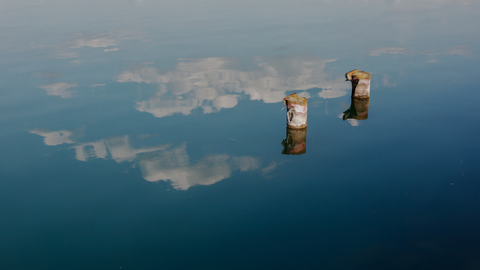
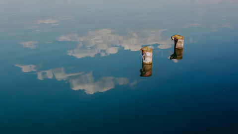
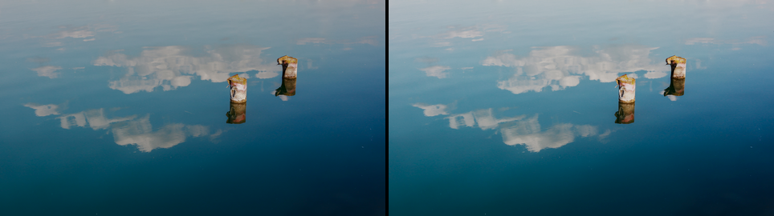
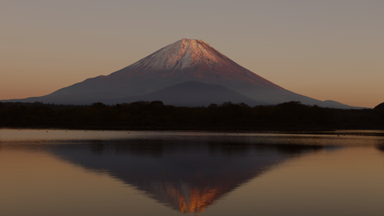
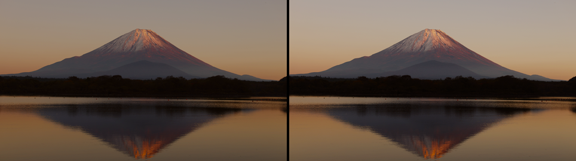
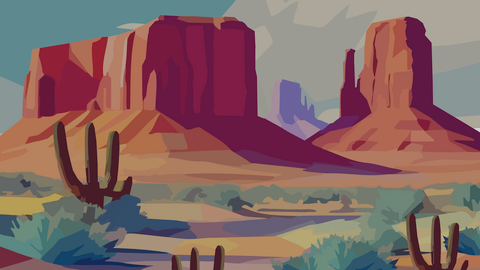
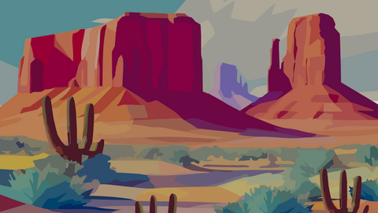
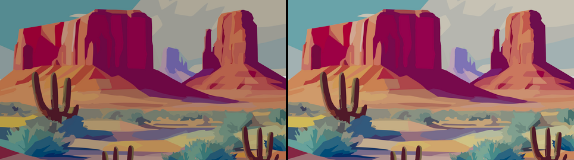

# 对照图（真实照片）

由 `scripts/make_gallery.py` 生成，`--check` 校验清单与图片指纹。

**这些是预览映射，不是上屏结果**：脚本用 Reinhard 把 HDR 输出压到 8 位再按 sRGB 编码，真机上 head 以上的能量由 EDR 屏幕还原。所以这些图能说明「哪些区域被抬起来、有没有偏色、有没有硬裁」，不能说明最终观感。

参数：`--head 2`（2× headroom）、SDR 侧 `--sat 1`、HDR 侧 `--sat 1.15`（同时展示抬亮与提饱和）。

## 云层：大面积极亮天空 + 暗地景

| SDR（`--sat 1`） | 自动 HDR（head 2，sat 1.15） |
|---|---|
|  |  |

并排：[Clouds_by_Tibor_Mokanszki-pair.png](img/Clouds_by_Tibor_Mokanszki-pair.png) ・ 高光 4× 裁切：[Clouds_by_Tibor_Mokanszki-crop.png](img/Clouds_by_Tibor_Mokanszki-crop.png)

**两档对照**（左：缺省档，只在白点以上扩张 ｜ 右：内容档 `--map bt2408`，纸白 203 nit 线性化）：。两档预览的实测差：平均 **15.2 级**、**78%** 的像素差 > 4 级（这两张图用同一套 Reinhard 预览映射，所以差值是真实的内容差，不是曝光归一化后的错觉）。内容档把绝大部分像素一起抬高（实测 98%–100% 的码值变化），所以它是 `S2A_HDR_MAP=1` 的可选项，不是默认。

## 富士山：雪面高光与蓝天渐变

| SDR（`--sat 1`） | 自动 HDR（head 2，sat 1.15） |
|---|---|
|  |  |

并排：[Fuji_san_by_amaral-pair.png](img/Fuji_san_by_amaral-pair.png) ・ 高光 4× 裁切：[Fuji_san_by_amaral-crop.png](img/Fuji_san_by_amaral-crop.png)

**两档对照**（左：缺省档，只在白点以上扩张 ｜ 右：内容档 `--map bt2408`，纸白 203 nit 线性化）：。两档预览的实测差：平均 **14.1 级**、**74%** 的像素差 > 4 级（这两张图用同一套 Reinhard 预览映射，所以差值是真实的内容差，不是曝光归一化后的错觉）。内容档把绝大部分像素一起抬高（实测 98%–100% 的码值变化），所以它是 `S2A_HDR_MAP=1` 的可选项，不是默认。

## 纪念碑谷：暖色岩壁，色相最容易跑偏

| SDR（`--sat 1`） | 自动 HDR（head 2，sat 1.15） |
|---|---|
|  |  |

并排：[Monument_valley_by_orbitelambda-pair.png](img/Monument_valley_by_orbitelambda-pair.png) ・ 高光 4× 裁切：[Monument_valley_by_orbitelambda-crop.png](img/Monument_valley_by_orbitelambda-crop.png)

**两档对照**（左：缺省档，只在白点以上扩张 ｜ 右：内容档 `--map bt2408`，纸白 203 nit 线性化）：。两档预览的实测差：平均 **18.3 级**、**95%** 的像素差 > 4 级（这两张图用同一套 Reinhard 预览映射，所以差值是真实的内容差，不是曝光归一化后的错觉）。内容档把绝大部分像素一起抬高（实测 98%–100% 的码值变化），所以它是 `S2A_HDR_MAP=1` 的可选项，不是默认。

## 图片指纹

| 文件 | sha256 |
|---|---|
| `docs/img/Clouds_by_Tibor_Mokanszki-sdr.png` | `6f81e1be1670585c…` |
| `docs/img/Clouds_by_Tibor_Mokanszki-hdr.png` | `15d50b0d4f78b820…` |
| `docs/img/Clouds_by_Tibor_Mokanszki-pair.png` | `63aac56e3c5d9d43…` |
| `docs/img/Clouds_by_Tibor_Mokanszki-crop.png` | `1283c7a876353b8b…` |
| `docs/img/Clouds_by_Tibor_Mokanszki-content.png` | `75247c3fb10701a1…` |
| `docs/img/Clouds_by_Tibor_Mokanszki-map-pair.png` | `74912cbe1212c8d5…` |
| `docs/img/Fuji_san_by_amaral-sdr.png` | `bcc8b863e114d926…` |
| `docs/img/Fuji_san_by_amaral-hdr.png` | `1d6318f193c23e16…` |
| `docs/img/Fuji_san_by_amaral-pair.png` | `34cfc3d5096f31ff…` |
| `docs/img/Fuji_san_by_amaral-crop.png` | `3e2dd29690ef9a2f…` |
| `docs/img/Fuji_san_by_amaral-content.png` | `28b54912b01fce47…` |
| `docs/img/Fuji_san_by_amaral-map-pair.png` | `8fa4747b540ce374…` |
| `docs/img/Monument_valley_by_orbitelambda-sdr.png` | `a5e4b4618f5d311a…` |
| `docs/img/Monument_valley_by_orbitelambda-hdr.png` | `13f3e76401ee4f8c…` |
| `docs/img/Monument_valley_by_orbitelambda-pair.png` | `bcfc3be478619f42…` |
| `docs/img/Monument_valley_by_orbitelambda-crop.png` | `9112865b92af4bb6…` |
| `docs/img/Monument_valley_by_orbitelambda-content.png` | `9ba29a510eaa35e2…` |
| `docs/img/Monument_valley_by_orbitelambda-map-pair.png` | `ce575c281183e267…` |
